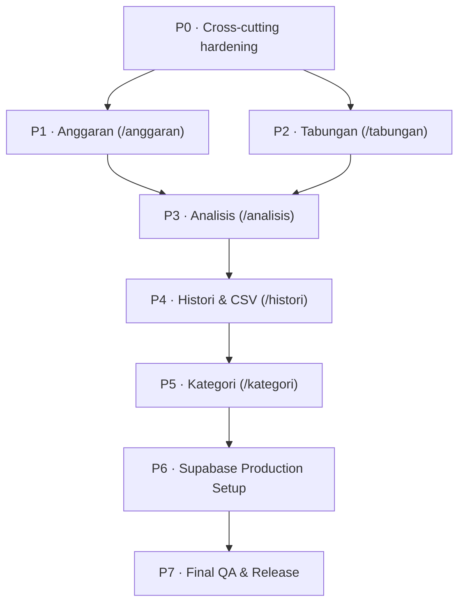

# Project Tasks & Roadmap: Money Tracker

> **Notice for AI Agents & Developers**:  
> This file contains the complete, up-to-date roadmap, architecture context, completed milestones, and actionable backlog for the **Money Tracker** application. Always refer to this document alongside `AGENTS.md` before starting any new task.

---

## 1. Project Overview & Tech Stack

- **Framework**: Next.js 16 (App Router, Turbopack, React 19)
- **Language**: TypeScript (`tsconfig.json`, `@/*` alias)
- **Styling**: Tailwind CSS with CSS variables, Lucide React icons
- **UI Components**: shadcn-style Base UI primitives (`@base-ui/react` in `components/ui/`)
- **Backend & Auth**: Supabase (PostgreSQL, Row Level Security, Google OAuth, `@supabase/ssr`)
- **Validation**: Zod (`lib/validation.ts`)
- **Charts**: Recharts (`components/dashboard/trend-chart.tsx`, etc.)
- **Notifications**: Sonner (`toast` from `sonner`)
- **Language & Locale**: Indonesian (IDR currency `Rp`, dates formatted with `date-fns/locale/id`)

---

## 2. Completed Milestones (✅)

### 2.1 Foundation & Architecture
- [x] Next.js 16 App Router scaffolding with TypeScript & Tailwind CSS.
- [x] UI component library installed in `components/ui/` (Button, Dialog, AlertDialog, Sheet, Input, Label, Badge, Card, Table, Select, Popover, Progress, Sonner, etc.).
- [x] Supabase server & client factories (`lib/supabase/server.ts`, `lib/supabase/client.ts`).
- [x] Route protection proxy (`proxy.ts` replacing legacy middleware) with public path guards (`/`, `/login`, `/auth`).
- [x] Helper utilities:
  - Indonesian currency & date formatting (`lib/format.ts`).
  - Zod schemas and TypeScript types (`lib/validation.ts`, `lib/types.ts`).
  - Analytics calculation utilities (`lib/analytics.ts`).
  - Centralized database query helpers (`lib/data.ts`).
- [x] Complete SQL migration schema written (`supabase/migrations/0001_init.sql`) with tables, triggers, RPC function, and RLS policies.

### 2.2 Authentication & App Shell
- [x] Landing page with hero CTA and automated auth redirect (`app/page.tsx`).
- [x] Login page with Google OAuth trigger (`app/(auth)/login/page.tsx`, `lib/auth/actions.ts`).
- [x] OAuth callback route handler (`app/auth/callback/route.ts`).
- [x] Protected dashboard layout with user profile retrieval (`app/(dashboard)/layout.tsx`).
- [x] Responsive app shell (`components/layout/dashboard-shell.tsx`) with desktop sidebar, mobile drawer sheet, and topbar (`components/layout/topbar.tsx`).
- [x] Central navigation definitions (`components/nav.ts`).

### 2.3 Dashboard Overview (`/dashboard`)
- [x] Overview page (`app/(dashboard)/dashboard/page.tsx`) with 4 metric cards:
  - Saldo Bersih (Net Cash Flow)
  - Total Pemasukan (+ MoM%)
  - Total Pengeluaran (+ MoM%)
  - Total Tabungan (+ Savings Rate%)
- [x] 6-Month Income vs Expense Trend Bar Chart (`components/dashboard/trend-chart.tsx`).
- [x] Top 5 Category Spending Breakdown with progress bars (`components/dashboard/category-breakdown.tsx`).
- [x] Recent Transactions List widget (`components/dashboard/recent-transactions.tsx`).
- [x] Monthly Budget Health widget (`components/dashboard/budget-summary-widget.tsx`).
- [x] Savings Goals widget with progress percentages (`components/dashboard/goals-summary-widget.tsx`).

### 2.4 Transaction System (`/transaksi`)
- [x] Server actions with Zod validation and cache revalidation (`lib/actions/transactions.ts`):
  - `createTransaction`
  - `updateTransaction`
  - `deleteTransaction`
- [x] Add/Edit transaction modal (`components/transactions/transaction-dialog.tsx`) with type toggle (Pengeluaran, Pemasukan, Tabungan), dynamic categories, Rupiah live preview, and date input.
- [x] Delete confirmation dialog (`components/transactions/delete-transaction-dialog.tsx`).
- [x] Search & filter bar (`components/transactions/transaction-filters.tsx`) supporting search text, month, type, and category filters via URL search params.
- [x] Financial summary banner (`components/transactions/transaction-stats.tsx`) displaying Arus Kas Bersih, Pemasukan, Pengeluaran, and Tabungan.
- [x] Transaction data table (`components/transactions/transaction-table.tsx`) with colored badges, date formatting, pagination, and empty state.
- [x] Transaction page (`app/(dashboard)/transaksi/page.tsx`).

### 2.5 Shared Infrastructure Ready for Remaining Modules
These helpers already exist and are consumed by the dashboard, but their dedicated routes/UI are not built yet:

- [x] `listBudgetsForMonth()` in `lib/data.ts` (note: actual name differs from the old `listBudgets` plan).
- [x] `listGoalsWithProgress()` and `getGoalTotals()` in `lib/data.ts`.
- [x] `budgetStatuses()`, `largestExpense()`, `requiredPerMonth()`, `byCategory()`, `totalsByMonth()` in `lib/analytics.ts`.
- [x] Zod schemas for budgets, goals, contributions, and categories in `lib/validation.ts`.
- [x] Database tables, RLS, `contribute_to_goal` RPC, and `monthly_summary` view in `supabase/migrations/0001_init.sql`.
- [x] Dashboard widgets consume budget/goal helpers and link to `/anggaran` and `/tabungan`.

> ⚠️ **Known dead links**: `components/nav.ts` and dashboard widgets link to `/anggaran`, `/tabungan`, `/analisis`, `/histori`, and `/kategori`, but those route files do not exist. They currently return 404. See P0.6 for handling.

### 2.6 Environment, Database & Tooling Progress (2026-10-27)
- [x] Supabase project connected via `.env.local`; Auth health check returns HTTP 200.
- [x] Google OAuth sign-in confirmed through authenticated requests in the dev server logs.
- [x] `0001_init.sql` hardened (expression unique index, `extract(day from month)` check, `security_invoker` view, idempotent policy drops) and applied to the linked project.
- [x] RLS enabled on all app tables with the migration's policies.
- [x] Global typography switched from Geist to Roboto / Roboto Mono (`app/layout.tsx`, `app/globals.css`).
- [x] `npm run lint` and `npm run build` pass.
- [x] Local dev server runs at `http://localhost:3000`.

---

## 3. Remaining Tasks & Action Plan (⏳)

> **Last audited**: 2026-10-27. This section is the execution source of truth.
> Update checkboxes as work lands. Keep the order unless a task explicitly says it can be parallelized.

### 3.1 Status Snapshot

| Module | Route | Status | Foundation present | Main blockers |
|---|---|---|---|---|
| Cross-cutting hardening | — | 🟡 In progress | Migration fixed; Supabase connected | P0.1–P0.4 and P0.6 still pending |
| Anggaran | `/anggaran` | ⏳ Not built | Data + analytics + schema | Actions, UI, page, revalidation integration |
| Tabungan | `/tabungan` | ⏳ Not built | Data + RPC + schema | Actions, contribution UI, page |
| Analisis | `/analisis` | ⏳ Not built | Analytics helpers + Recharts | Range queries, budget adherence helper, charts, page |
| Histori & CSV | `/histori` | ⏳ Not built | Transaction query helpers | Export route, date range UI, table, page |
| Kategori | `/kategori` | ⏳ Not built | Category queries + schema | CRUD actions, delete/reassign policy, UI, page |
| Supabase production | — | 🟡 Local configured | Migration applied; Google OAuth working | RLS two-user test and production deployment pending |

### 3.2 Execution Order, Dependencies & Definition of Done



- P0.5 (migration hardening) must be done before any live Supabase testing.
- P1–P5 can be developed in order; P3 depends on budgets and goals being real data producers.
- P6 is the gate before production deployment. P7 runs continuously and again at the end.
- **Definition of Done for every module**:
  - Server actions validate with Zod, scope every query by `user_id`, and revalidate all affected paths.
  - UI copy is Bahasa Indonesia; amounts use `rupiah()`; dates use `tanggal()`/`tanggalPendek()`.
  - Empty, loading, and error states exist.
  - Responsive at 375 px, 768 px, and 1280 px.
  - `npm run lint` and `npm run build` exit with code `0`.
  - TASK.md checkboxes and README (if user-facing behavior changed) are updated.

---

### 3.3 Priority 0 — Cross-Cutting Hardening (do first)

**Goal**: Remove shared blockers and correctness gaps before building feature pages.

- [ ] **P0.1 Shared month picker (`components/shared/month-picker.tsx`)**
  - Client component reading/writing the `month` URL search param (`yyyy-MM`).
  - Prev/next arrows, dropdown for the last 12 months, default `bulanIni()`.
  - Remove `month` param when selecting the current month (keeps URLs clean).
  - Reuse in `/anggaran`, `/analisis`, and `/histori`.

- [ ] **P0.2 Shared action helpers (`lib/actions/helpers.ts`)**
  - `requireUser()` → returns `{ supabase, user }` or a standard `ActionResult` error.
  - `revalidateFinance()` → revalidates the full matrix:
    - Transactions → `/transaksi`, `/dashboard`, `/anggaran`, `/analisis`, `/histori`.
    - Budgets → `/anggaran`, `/dashboard`, `/analisis`.
    - Goals/contributions → `/tabungan`, `/dashboard`, `/analisis`, `/transaksi`.
    - Categories → `/kategori`, `/transaksi`, `/anggaran`, `/analisis`, `/dashboard`.
  - Refactor `lib/actions/transactions.ts` to use it. **Current gap**: transaction mutations do not revalidate `/anggaran`.

- [ ] **P0.3 Validation hardening (security & data integrity)**
  - In `createTransaction` / `updateTransaction`, verify the category:
    - exists,
    - belongs to the authenticated user,
    - `category.kind === transaction.type`.
  - In budget actions, only allow categories with `kind = 'expense'`.
  - Return Indonesian errors for cross-user or mismatched-kind attempts.

- [ ] **P0.4 Analytics semantics fixes (`lib/analytics.ts`)**
  - `budgetStatuses()`: change `over` to `spent > limit` (currently `>=` marks exactly-at-limit as over-budget).
  - Add a stable status field: `safe` (`usedPct < 0.8`), `warning` (`0.8 <= usedPct <= 1`), `over` (`usedPct > 1`).
  - Decide and document savings-rate semantics:
    - Current `savingsRate = net / income`, where `net = income - expense - savings`, i.e. it is actually a **net margin**, not a savings rate.
    - Recommended: add `savingsRate = savings / income` and `netMargin = net / income`. Use `savingsRate` for the dashboard "Rasio tabungan" and analytics; keep `net` for "Saldo Bersih".
    - Apply the same change in both `totalsByMonth()` and `totalsFromSummary()`; extract shared finalization logic to prevent drift.
  - Update dashboard copy if the semantic decision changes the displayed number.

- [x] **P0.5 Database migration hardening (BLOCKER) — `supabase/migrations/0001_init.sql`**
  - **Completed 2026-10-27.** The script failed on a fresh PostgreSQL/Supabase project. The fixes below are now in the repo and applied to the linked project:
    1. `budgets.month` check uses `day(month)`, which is not a PostgreSQL function. Replace with:
       ```sql
       check (extract(day from month) = 1)
       -- or: check (month = date_trunc('month', month)::date)
       ```
    2. `categories` uses `unique (user_id, kind, lower(name))` as a table constraint. PostgreSQL does not allow expressions in table-level unique constraints. Remove it and add:
       ```sql
       create unique index if not exists categories_user_kind_name_key
         on public.categories (user_id, kind, lower(name));
       ```
    3. `monthly_summary` cannot have RLS enabled / policies applied directly on a view. Replace the tail with a security-invoker view:
       ```sql
       create or replace view public.monthly_summary
       with (security_invoker = true) as
       select ...;
       ```
       Remove `alter view ... enable row level security` and `create policy ... on public.monthly_summary`.
    4. Make policies idempotent (`drop policy if exists ...` before `create policy`, or a guarded `do $$` block) so re-running migration scripts does not fail.
  - If `0001_init.sql` has **never** been applied, fix it in place.
  - If it has already been applied, add `supabase/migrations/0002_hardening.sql` instead and document the change.
  - Verify by running the script against a fresh Supabase project or local Supabase stack.

- [ ] **P0.6 Dead-link handling (only if deploying before all modules exist)**
  - Create lightweight "Segera Hadir" placeholder pages for unbuilt routes, or hide not-yet-built items from `NAV_ITEMS`.
  - Remove this task once P1–P5 are complete.

**P0 acceptance criteria**
- [x] `npm run lint` and `npm run build` pass.
- [x] Migration applies cleanly to a fresh database.
- [ ] Exactly-at-limit budgets are `warning`, not `over`.
- [ ] A transaction cannot reference another user's category or a category of the wrong kind.
- [ ] Adding/editing/deleting a transaction refreshes `/anggaran`.

---

### 3.4 Priority 1 — Fitur Anggaran (`/anggaran`)

**Goal**: Allow users to set monthly spending limits per expense category, track progress in real time, and get warned when approaching or exceeding limits.

**Files**
- `lib/actions/budgets.ts` (new)
- `components/budgets/budget-dialog.tsx`
- `components/budgets/delete-budget-dialog.tsx`
- `components/budgets/budget-card.tsx` (or `budget-list.tsx`)
- `components/budgets/budget-stats.tsx`
- `app/(dashboard)/anggaran/page.tsx`
- Optional: `app/(dashboard)/anggaran/loading.tsx`

**Action plan**
- [ ] **1.1 Server actions (`lib/actions/budgets.ts`)**
  - `createBudget(values)`: parse with `budgetSchema`; normalize month to `${month}-01`; verify expense category ownership; translate unique-constraint violation (`23505`) into "Anggaran untuk kategori ini sudah ada di bulan tersebut".
  - `updateBudget(id, values)`: scope by `id` + `user_id`; keep category/month immutable in edit mode (only limit changes) to avoid duplicate conflicts.
  - `deleteBudget(id)`: scope by `id` + `user_id`.
  - Use `revalidateFinance()`; revalidate `/anggaran`, `/dashboard`, `/analisis`.
- [ ] **1.2 Data helpers**
  - Reuse `listBudgetsForMonth(client, month)` (already implemented).
  - Fetch budgets and month transactions in parallel on the page.
  - Verify `budgetStatuses()` output after P0.4.
- [ ] **1.3 UI components (`components/budgets/`)**
  - `budget-dialog.tsx`: add/edit limit. Add mode shows expense categories that do not already have a budget for the selected month; edit mode only edits the nominal.
  - `delete-budget-dialog.tsx`: confirmation with category and limit.
  - `budget-card.tsx`: category color dot, limit vs spent, remaining, progress bar, status badge.
    - `< 80%` → green "Aman".
    - `80%–100%` → yellow "Mendekati Batas".
    - `> 100%` → red "Melebihi Batas" plus overage amount.
  - `budget-stats.tsx`: Total Anggaran, Total Terpakai, Sisa Anggaran, Kategori Melebihi Batas.
  - Use the shared `MonthPicker` from P0.1.
- [ ] **1.4 Page (`app/(dashboard)/anggaran/page.tsx`)**
  - Read `month` from `searchParams` (Promise in Next.js 16); default `bulanIni()`; validate `yyyy-MM` and fall back to current month.
  - Parallel fetch budgets + month transactions.
  - Render header, stats, month picker, budget grid, and "Tambah Anggaran" button.
  - Empty state: "Belum ada anggaran bulan ini" + CTA.
- [ ] **1.5 Integration**
  - Ensure P0.2 adds `/anggaran` to transaction revalidation.
  - Dashboard budget widget already renders these rows; confirm it reflects changes.

**Acceptance criteria**
- [ ] One budget per category per month; duplicate attempts show a friendly message.
- [ ] Create/edit/delete updates the list, stats, and dashboard widget.
- [ ] Spent amount matches expense transactions in the selected month.
- [ ] Progress colors and labels match the thresholds.
- [ ] Month switching works via URL and survives refresh.

**Edge cases**
- Invalid `month` param → fallback, no crash.
- Category deleted → its budget cascades away (database behavior).
- Month with no budgets → empty state; month with budgets but no transactions → 0% used.
- Exactly 100% used is "Mendekati Batas", not "Melebihi Batas".

---

### 3.5 Priority 2 — Fitur Tabungan / Target Finansial (`/tabungan`)

**Goal**: Enable users to create savings goals, record contributions (which also create savings transactions), and view target timelines.

**Files**
- `lib/actions/goals.ts` (new)
- `components/goals/goal-dialog.tsx`
- `components/goals/contribution-dialog.tsx`
- `components/goals/delete-goal-dialog.tsx`
- `components/goals/goal-card.tsx`
- `components/goals/goal-stats.tsx`
- `app/(dashboard)/tabungan/page.tsx`

**Action plan**
- [ ] **2.1 Server actions (`lib/actions/goals.ts`)**
  - `createGoal` / `updateGoal`: parse with `goalSchema`; normalize empty deadline to `null`.
  - `deleteGoal`: scope by `user_id`. Use a confirmation that explains contributions are removed and historical savings transactions remain in `/transaksi` (decide and document this behavior).
  - `contributeToGoal`: parse with `contributionSchema`; ensure the goal is owned by the user and `status = 'active'`; call `contribute_to_goal` RPC; surface RPC error messages in Indonesian; revalidate `/tabungan`, `/dashboard`, `/analisis`, `/transaksi`.
  - `updateGoalStatus(id, status)`: validate against `GOAL_STATUSES`; define allowed transitions (recommended: active ↔ archived; achieved → archived; archived → active; never move achieved back to active unless user explicitly reactivates).
- [ ] **2.2 Data helpers**
  - Reuse `listGoalsWithProgress(client)`.
  - Add optional `status` filter to the query, or filter in the page after fetching.
- [ ] **2.3 UI components (`components/goals/`)**
  - `goal-dialog.tsx`: name, target amount, optional deadline; edit mode prefills.
  - `contribution-dialog.tsx`: amount, date, live Rupiah preview, current progress summary.
  - `delete-goal-dialog.tsx`: confirmation with saved amount and warning about ledger history.
  - `goal-card.tsx`: name, progress bar (cap display at 100%), saved vs target, remaining, deadline countdown, required-per-month estimate using `requiredPerMonth()`, and actions.
  - `goal-stats.tsx`: Total Target Terkumpul, Total Target Aktif, Rata-rata Capaian.
- [ ] **2.4 Page (`app/(dashboard)/tabungan/page.tsx`)**
  - Status tabs via search param `?status=active|achieved|archived`, default `active`.
  - Grid of goal cards + "Buat Target" button.
  - Empty states per tab.

**Acceptance criteria**
- [ ] Contribution creates exactly one savings transaction and one contribution row via the RPC.
- [ ] Goal auto-marks `achieved` when total contributions reach the target.
- [ ] Progress and stats update on `/tabungan` and `/dashboard`.
- [ ] Status tabs filter correctly and survive refresh.
- [ ] Archived/achieved goals cannot receive contributions.

**Edge cases & decisions**
- Deadline in the past: allow saving, but show "Batas waktu terlewat".
- Deadline empty: hide per-month estimate.
- Saved amount above target: show 100% progress and "Tercapai".
- Deleting a savings transaction linked to a contribution: current FK is `on delete set null`, so goal progress remains. Decide whether to:
  - delete the contribution when its linked transaction is deleted, or
  - keep it and show a "tanpa transaksi" note. Document the chosen behavior in the UI and TASK.md.
- Deleting a goal: contributions cascade, savings transactions remain.

---

### 3.6 Priority 3 — Fitur Analisis Finansial & Grafik (`/analisis`)

**Goal**: Provide in-depth financial insights: category distribution, spending behavior, savings trends, and budget adherence.

**Files**
- `components/analytics/monthly-trend-chart.tsx`
- `components/analytics/category-pie-chart.tsx`
- `components/analytics/spending-behavior-card.tsx`
- `components/analytics/timeframe-selector.tsx`
- `app/(dashboard)/analisis/page.tsx`
- Additions to `lib/data.ts` and `lib/analytics.ts`

**Action plan**
- [ ] **3.1 Range-aware data layer**
  - Read `range` from `searchParams`: `1`, `3`, `6`, or `12` months (default `6`).
  - Fetch transactions since the start of the range with `listTransactionsSince()`.
  - Fetch budgets across the range; add `listBudgetsBetween(client, fromMonth, toMonth)` or query per month.
  - Use `totalsByMonth()` for monthly series and `byCategory()` for the pie chart.
  - Guard against the Supabase default 1,000-row response cap for large ranges; paginate if needed.
- [ ] **3.2 Analytics helpers**
  - `budgetAdherence(budgets, txs)`: total limit vs total spent, percentage, over-budget category count.
  - `dailyAverage()`: use the number of days in the selected period, not just elapsed days.
  - Apply the P0.4 savings-rate definition consistently.
  - Add `largestExpense()` usage for "Pengeluaran Terbesar".
- [ ] **3.3 UI components (`components/analytics/`)**
  - `monthly-trend-chart.tsx`: Recharts `ComposedChart` with income/expense bars and savings/net line; reuse tooltip and `rupiahShort` conventions.
  - `category-pie-chart.tsx`: donut chart with category colors, legend, percentage tooltips, and empty state.
  - `spending-behavior-card.tsx`: Pengeluaran Terbesar, Rata-rata Pengeluaran Harian, Rasio Tabungan, Ketaatan Anggaran.
  - `timeframe-selector.tsx`: 1/3/6/12-month pills that update the `range` URL param (no dead state).
- [ ] **3.4 Page (`app/(dashboard)/analisis/page.tsx`)**
  - Assemble the timeframe selector, KPI cards, trend chart, pie chart, and behavior card.
  - Responsive grid: charts stack on mobile.
  - Empty state when the selected range has no transactions.

**Acceptance criteria**
- [ ] Range selector changes all charts and KPIs consistently.
- [ ] Category percentages sum to ~100% (with rounding tolerance).
- [ ] Largest expense, daily average, savings rate, and budget adherence are correct for the selected range.
- [ ] Budget adherence only includes expense budgets and matching expense transactions.
- [ ] Charts render without hydration or Recharts container warnings.

---

### 3.7 Priority 4 — Fitur Histori & Ekspor CSV (`/histori`)

**Goal**: Provide a full transaction ledger with date-range filters and a reliable CSV export.

**Files**
- `app/api/export/route.ts` (new)
- `lib/export.ts` (optional helpers)
- `components/history/date-range-filter.tsx`
- `components/history/export-csv-button.tsx`
- `components/history/history-table.tsx`
- `app/(dashboard)/histori/page.tsx`

**Action plan**
- [ ] **4.1 CSV export (`app/api/export/route.ts`)**
  - `GET` handler with `from` and `to` query params; authenticate with the server Supabase client.
  - Scope by the authenticated user; reject unauthenticated requests.
  - Fetch **all** matching rows, paginating in chunks of 1,000 (Supabase default limit).
  - Columns: `Tanggal, Jenis, Kategori, Nominal, Catatan`.
  - Escape quotes/commas/newlines; prepend UTF-8 BOM (`\uFEFF`) so Excel renders Indonesian characters correctly.
  - Prevent CSV formula injection: prefix cells beginning with `=`, `+`, `-`, or `@` with an apostrophe.
  - Set `Content-Type: text/csv; charset=utf-8` and `Content-Disposition: attachment; filename="transaksi-YYYY-MM-DD.csv"`.
  - Return a 400 with an Indonesian message when `from > to`.
- [ ] **4.2 UI components (`components/history/`)**
  - `date-range-filter.tsx`: From/To date inputs synced to URL params; validation and "Reset" action.
  - `export-csv-button.tsx`: triggers the route handler with the active filters; disabled when there are no rows.
  - `history-table.tsx`: full ledger with sortable Date and Amount columns (URL `sort`/`dir` or client-side sort), pagination, and empty state.
- [ ] **4.3 Page (`app/(dashboard)/histori/page.tsx`)**
  - Read `from`, `to`, `page`, `sort`, `dir` from `searchParams`.
  - Parallel fetch rows/count and category options if needed.
  - Render header, date filter, export button, summary count, and table.
  - Decide the overlap with `/transaksi`: `/transaksi` stays the quick month-based ledger; `/histori` focuses on arbitrary date ranges + export. Reuse table primitives where practical.

**Acceptance criteria**
- [ ] Date range is inclusive on both ends.
- [ ] Export contains only the authenticated user's rows and respects the active filters.
- [ ] Excel opens the file with correct Indonesian characters and no mangled currency.
- [ ] Sorting and pagination preserve active filters.
- [ ] No CSV injection risk.

**Edge cases**
- Empty result → export disabled or a harmless header-only file.
- Very large range → chunked fetch completes without truncation.
- `from`/`to` missing → default to current month or all data, document the choice.

---

### 3.8 Priority 5 — Fitur Manajemen Kategori (`/kategori`)

**Goal**: Let users customize expense, income, and savings categories with colors, while protecting default data.

**Files**
- `lib/actions/categories.ts` (new)
- `components/categories/category-dialog.tsx`
- `components/categories/category-list.tsx`
- `components/categories/delete-category-dialog.tsx`
- `app/(dashboard)/kategori/page.tsx`

**Action plan**
- [ ] **5.1 Server actions (`lib/actions/categories.ts`)**
  - `createCategory`: parse with `categorySchema`; friendly duplicate-name message for the same kind.
  - `updateCategory`: scope by `user_id`; block changing `kind` when transactions exist (otherwise historical analytics break).
  - `deleteCategory`:
    - Block `is_default = true` categories server-side, not only in the UI.
    - For custom categories, reassign existing transactions to a fallback category of the same kind (prefer "Lain-lain" for expense / "Lainnya" for income / "Tabungan" for savings), then delete. If no fallback exists, block with an explanatory message.
    - Note: budgets referencing the category cascade-delete; surface this in the confirmation.
  - Revalidate `/kategori`, `/transaksi`, `/anggaran`, `/analisis`, `/dashboard`.
- [ ] **5.2 UI components (`components/categories/`)**
  - `category-dialog.tsx`: name, kind (create only), color palette from `CATEGORY_COLORS`, live preview, duplicate-name handling.
  - `category-list.tsx`: grouped by Pengeluaran, Pemasukan, Tabungan; show color dot, name, transaction usage count, "Default" badge, edit/delete actions.
  - `delete-category-dialog.tsx`: warning that existing transactions move to the fallback category and related budgets are removed.
- [ ] **5.3 Page (`app/(dashboard)/kategori/page.tsx`)**
  - Fetch categories and usage counts.
  - Render groups, add button, empty state per group.

**Acceptance criteria**
- [ ] Default categories cannot be deleted from either UI or server action.
- [ ] Custom category creation enforces unique name per kind.
- [ ] Deleting a category never leaves transactions pointing to a deleted category (reassigned or blocked).
- [ ] Category changes refresh transaction forms, budgets, and analytics.

**Decisions needed**
- Whether default categories may be renamed/recolored (recommended: allow color changes, block rename and delete).
- Fallback category behavior when the user deleted the default fallback.

---

### 3.9 Priority 6 — Supabase Production Setup & Verification

**Goal**: Connect the app to a live Supabase backend and verify auth, schema, and RLS end-to-end.

- [x] **6.1 Migration** — completed 2026-10-27 against the linked project.
  - Complete P0.5 first.
  - Apply `0001_init.sql` (and `0002_hardening.sql` if applicable) via Supabase SQL Editor or `supabase db push`.
  - Verify tables: `profiles`, `categories`, `transactions`, `budgets`, `savings_goals`, `goal_contributions`.
  - Verify the `monthly_summary` view uses `security_invoker = true`.
  - Verify trigger `on_auth_user_created` creates a profile and default categories.
  - Verify `contribute_to_goal` exists and is callable.
- [x] **6.2 Google OAuth** — completed 2026-10-27; authenticated sessions confirmed.
  - Supabase Dashboard → Authentication → Providers → Google: enable and add Google Cloud `Client ID`/`Client Secret`.
  - Add authorized redirect URI: `https://<project-ref>.supabase.co/auth/v1/callback`.
  - Google Cloud Console authorized origins/redirects must match the Supabase callback.
- [x] **6.3 Supabase URL configuration** — localhost site/redirect URLs configured.
  - Site URL: `http://localhost:3000` for dev; production URL for deployment.
  - Redirect URLs: `http://localhost:3000/auth/callback` and the production equivalent.
- [x] **6.4 Environment variables (`.env.local`, never committed)** — local values set 2026-10-27.
  ```env
  NEXT_PUBLIC_SUPABASE_URL=https://your-project-ref.supabase.co
  NEXT_PUBLIC_SUPABASE_ANON_KEY=your-anon-key
  NEXT_PUBLIC_SITE_URL=http://localhost:3000
  ```
  - Set production equivalents in the hosting provider.
- [ ] **6.5 RLS smoke test**
  - Sign in as user A and user B in separate browsers/profiles.
  - Confirm each sees only their own categories, transactions, budgets, goals, and contributions.
  - Attempt a direct query/action against the other user's row and confirm it is rejected.
  - Confirm the `monthly_summary` view respects RLS without exposing other users' rows.
- [ ] **6.6 Deployment**
  - Configure the same environment variables.
  - Update Supabase Auth Site URL / Redirect URLs to the production origin.
  - Verify Google login, callback, and logout in production.

**Acceptance criteria**
- [x] Fresh sign-in seeds a profile and default categories.
- [x] Google OAuth returns to `/auth/callback` and lands on `/dashboard`.
- [ ] RLS blocks cross-user reads and writes.
- [x] No placeholder credentials remain in `.env.local`.

---

### 3.10 Priority 7 — Final QA & Release Checklist

- [ ] **Verification commands**
  - `npm run lint`
  - `npm run build`
  - Both must exit `0` with no warnings that indicate runtime problems.
- [ ] **Route smoke test** (authenticated): `/dashboard`, `/transaksi`, `/anggaran`, `/tabungan`, `/analisis`, `/histori`, `/kategori`.
- [ ] **Unauthenticated redirects**: protected routes redirect to `/login`; `/login`, `/`, `/auth/*` remain public.
- [ ] **CRUD matrix**: create/edit/delete transaction, budget, goal, contribution, category; verify list, stats, and dashboard updates.
- [ ] **Responsive check**: mobile drawer, tables, dialogs, charts at 375/768/1280 px.
- [ ] **Localization check**: all new copy in Bahasa Indonesia; no raw ISO dates; all amounts use `rupiah()`.
- [ ] **Empty/loading/error states** for every new page; add `loading.tsx` and `error.tsx` where beneficial.
- [ ] **Revalidation matrix** verified after each mutation.
- [ ] **Data integrity**: no orphan transactions/categories/budgets; contribution totals equal goal progress.
- [ ] **Performance**: range queries paginate; no N+1 queries; indexes cover user/month lookups.
- [ ] **Optional quality gate**: add Vitest for pure helpers (`lib/analytics.ts`, `lib/export.ts`, validation schemas) if the project accepts a test dependency.
- [ ] **Docs**: update README/TASK.md with final routes, env setup, and known limitations.

---

### 3.11 Risks, Gaps & Decisions Log

| ID | Risk / gap | Impact | Mitigation / decision |
|---|---|---|---|
| R1 | `0001_init.sql` uses `day(month)`, expression inside a unique table constraint, and RLS on a view | Migration fails on a fresh project | Fix in P0.5 before any live testing |
| R2 | Nav links to unbuilt routes | 404s in deployed app | P0.6 placeholders or hide nav items until built |
| R3 | `savingsRate` is actually net margin | Misleading dashboard/analytics metric | Decide and implement in P0.4 |
| R4 | `budgetStatuses` treats exactly 100% as over budget | Wrong "Melebihi Batas" label | Change to `spent > limit` in P0.4 |
| R5 | Transactions can reference wrong-kind or another user's category | Broken budgets/analytics, cross-user data reference | Validate in P0.3 |
| R6 | Category deletion semantics undefined | Orphan transactions, lost budgets | Reassign custom category transactions; block defaults (P5) |
| R7 | Goal contribution vs. transaction deletion | Progress may not match ledger | Decide behavior in P2 and document |
| R8 | Supabase default 1,000-row cap | Incomplete analytics/export | Paginate range and export queries (P3/P4) |
| R9 | CSV formula injection | Spreadsheet security risk | Prefix dangerous cell starts in P4 |
| R10 | Month boundary/timezone inconsistency (`awalBulan` local vs `monthKeyMonthsAgo` UTC) | Off-by-one around midnight/month boundaries | Standardize on Asia/Jakarta or UTC in P0.4; add boundary checks |
| R11 | Re-running `create policy` fails | Migration re-run errors | Idempotent policy drops/guards in P0.5 |

---

## 4. Coding Conventions & Guardrails

When working on any task in this repo, agents MUST follow these rules:

1. **Next.js 16 App Router**:
   - Pages and layouts are Server Components by default. Add `"use client"` only for components needing client state or event handlers.
   - Page `searchParams` and `params` props are Promises in Next.js 16 (`const params = await searchParams;`).
   - Server Actions require `"use server"` at file top or action header. Always call `revalidatePath(...)` after mutations.
2. **Base UI Primitives (`@base-ui/react`)**:
   - The UI components in `components/ui/` use Base UI, **not** Radix UI.
   - Base UI Button does **not** support the `asChild` prop. When rendering links styled as buttons, use `buttonVariants(...)` with Next.js `<Link>`.
   - Modals use Base UI `Dialog` or `AlertDialog` structures. Do not call synchronous `setState` in `useEffect` when initializing forms; use key-based resetting (`<FormContent key={id} ... />`).
3. **TypeScript & Supabase Client**:
   - `createClient()` from `@/lib/supabase/server` creates an untyped server client configured with cookies. Use explicit TypeScript casting when querying custom projections (e.g. `(data as TransactionWithCategory[]) ?? []`).
   - Scope every mutation with `.eq("user_id", user.id)` in addition to RLS.
4. **UI Copy & Localization**:
   - All UI text, buttons, alerts, and placeholders must use **Bahasa Indonesia** unless explicitly requested otherwise.
   - Format currencies using `rupiah(amount)` from `lib/format.ts`.
   - Format dates using `tanggal(iso)` or `tanggalPendek(iso)` from `lib/format.ts`.
5. **Data & Query Safety**:
   - Validate every server action input with the matching Zod schema.
   - Verify related IDs (categories, goals) belong to the authenticated user before writing.
   - Paginate list/export queries; Supabase returns at most 1,000 rows by default.

---

## 5. Verification Commands

Before completing any task, execute these verification commands:
```bash
# 1. Check for ESLint errors & React hooks violations
npm run lint

# 2. Check full Next.js production build and TypeScript types
npm run build
```
Both commands must exit with code `0`.

**Last verified**: 2026-10-27 — both commands passed after the migration hardening and Roboto font change.

Additional checks for database work:
- Apply the migration to a fresh Supabase project and confirm no SQL errors.
- Verify RLS with two separate authenticated users.
- Confirm `monthly_summary` returns only the current user's rows.
